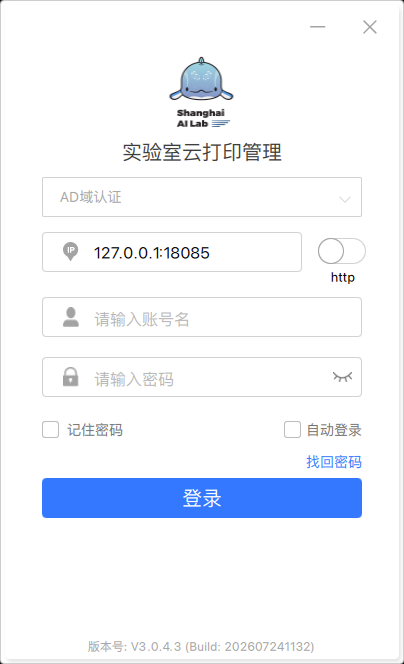

# PJLab 实验室打印 - macOS 安装包

这是根据实验室 Ubuntu 客户端和用户手册整理出的 Mac 方案。核心仍使用广东迅维提供的原厂客户端；辅助脚本负责校验原厂签名、安装 Rosetta、建立本机 HTTPS 兼容桥，并修复 CUPS 打印队列。

> [!IMPORTANT]
> **`.pkg` 安装包必须单独下载，请不要直接使用普通 `git clone` 得到的安装包。**
>
> 该文件由 Git LFS 管理。若本机未安装 Git LFS，或 LFS 对象下载失败，`git clone` 得到的 `.pkg` 可能只是一个 134 字节的指针文件，运行安装脚本时会出现完整性或 SHA-256 校验错误。
>
> 请[单独下载完整 `.pkg` 安装包](https://github.com/songjhPKU/Lab-Print-Service-MacOS/raw/refs/heads/main/insolu-PrintClient-PJ-Macos-sig-INSOLU-PDF-X86-v3.0.4.3.pkg)（112,960,237 字节，约 107.7 MiB），下载后把它与 `安装实验室打印机.command` 放在同一目录。完整文件的 SHA-256 应为 `1c89f605bb47b0d561f3a0cc9b6c4964bdb580ab007da5575e6baee88a5fa8a1`。

## 最快安装方式

1. 连接实验室网络或 VPN。
2. 双击 `安装实验室打印机.command`。
3. 终端要求密码时，输入这台 Mac 的登录密码并按回车。输入密码时屏幕不会显示字符。
4. 安装完成后，先确认第一栏显示 **AD域认证**，再输入实验室 AD 账号和密码。如果仍显示“请选择账号认证方式”，不要登录，重新运行本修正版脚本。
5. 打印时选择 **L1-Printer**。
6. 文件提交后不会立即出纸；到打印机旁刷卡，再在设备屏幕上释放任务。

## 使用截图

安装完成后，客户端登录界面应如下图所示。请确认认证方式为 **AD域认证**，服务器地址为 `127.0.0.1:18085`：

